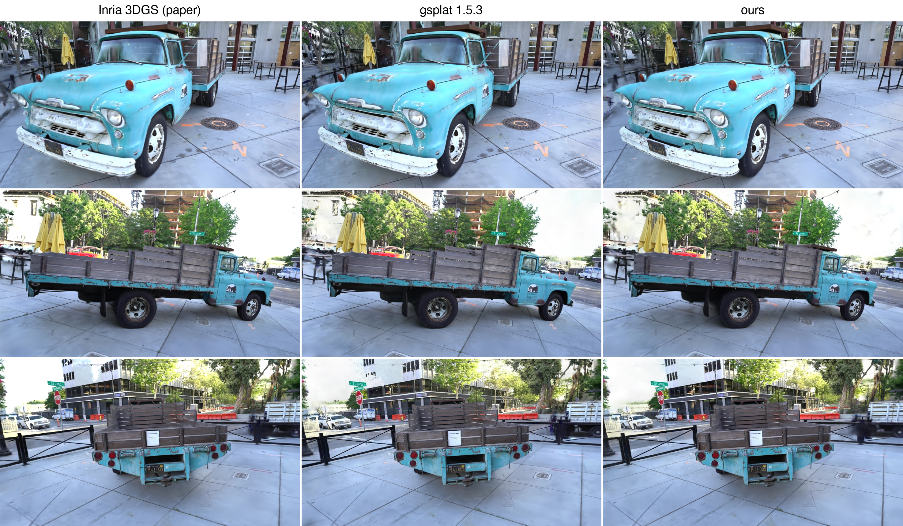

# 3D Gaussian Splatting

A minimal implementation of [3D Gaussian Splatting for Real-Time Radiance Field Rendering](https://repo-sam.inria.fr/fungraph/3d-gaussian-splatting/) built from the ground up with custom CUDA kernels.



## Overview

This project implements the core 3DGS rasterization algorithm entirely from scratch, including:
- Custom CUDA kernels for tile-based gaussian projection and rendering
- Differentiable rasterizer with PyTorch bindings
- Training pipeline with COLMAP dataset integration

## Performance

Coming Soon.

## Usage

```bash
uv sync
uv run python -m gaussian_splatting.main path/to/colmap/scene
```

**Dataset Structure:**
```
scene/
├── sparse/0/  # COLMAP reconstruction
└── images/    # Training images
```

You can download pre-processed COLMAP datasets from [here](https://demuc.de/colmap/datasets/).
